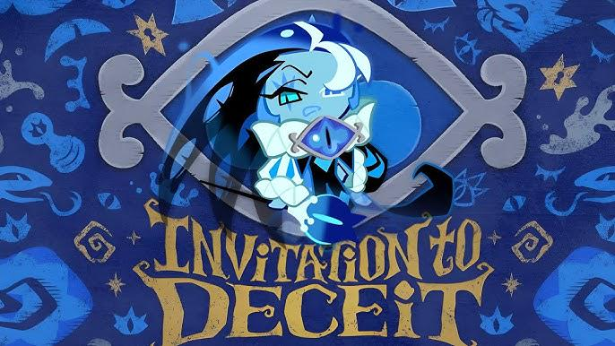
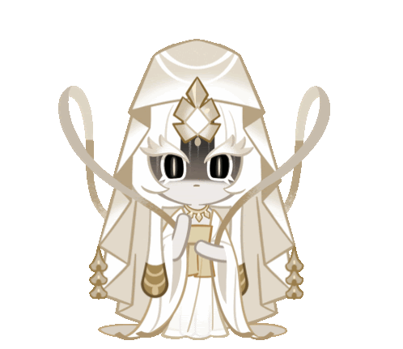
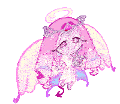
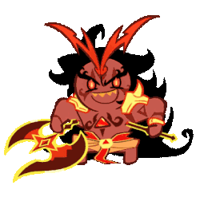
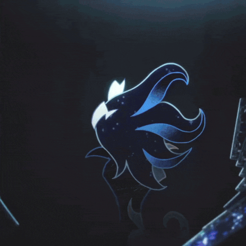
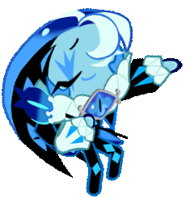
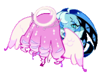
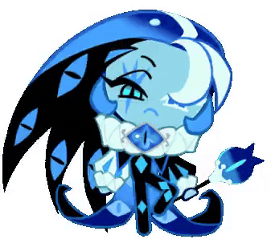

  

  
  
    

  <a href="./assets/Cookie%20Run%20Kingdom_%20Shadow%20Milk%20Cookie%E2%80%99s%20Gacha%20Theme%20(OST).mp3">
    <strong>CLICK!♫</strong>
  </a>
  

  

  

  

  

### If you don't like it, feel free to get out! I love my dears Sugar, Flour, Spice ♥  

  

<h1 align="center">
Cookie Tier:

  

> *"Ah! Finally! The stage is all set, the audience is breathing in hype, and every great performance requires a liiiiittle... misdirection. Isn't that absolutely right my darlings?"*

  

  
<h1 align="center">My dearest Soul Jam I love my Soul Jam more than anything~</h1>

<table align="center">
  <tr>
    <td align="center" valign="middle">
      
    </td>
    <td align="center" valign="middle">
      
    </td>
    <td align="center" valign="middle">
      
    </td>
  </tr>
</table>

  <h2>🌟 Gender & Pronouns 🎭</h2>

  <table>
    <tr>
      <td align="center">
        <b>🌊 Gender</b> 
        Genderfluid
      </td>
      <td align="center">
        <b>💫 Pronouns</b> 
        Any pronouns
      </td>
    </tr>
  </table>

  

<table>
  <tr>
    <td valign="top" width="65%">
      <h2>🎭 Status: <b>Live on Stage</b></h2>
      <ul>
        <li>🔭 <b>Currently Staging:</b> Rewriting the script of Beast-Yeast (without asking permission)</li>
        <li>🧵 <b>Favorite Prop:</b> Animatronic of Deceit / Heavy silk royal blue puppet strings</li>
        <li>💬 <b>Current Mood:</b> Performing for an audience of fools and fans alike, or foolish cookies I adore~</li>
        <li>📍 <b>Location:</b> Behind the curtain (or right behind you)</li>
      </ul>
    </td>
    <td valign="middle" width="35%" align="center">
      
    </td>
  </tr>
</table>

  

<table>
  <tr>
    <td valign="top" width="65%">
      <h2>📝 Program Notes </h2>
      <ul>
        <li><b>Role:</b> Beast Cookie of Deceit &amp; Grand Master of the Theatre of Delusion</li>
        <li><b>Alignment:</b> Chaotic - Theatrical</li>
        <li><b>Fun Fact:</b> I didn't break the seal—the seal simply realized it looked better shattered.</li>
        <li><b>Fanmail:</b> Send complaints directly into the nearest void; they make great acoustics.</li>
      </ul>
    </td>
    <td valign="middle" width="35%" align="center">
      
    </td>
  </tr>
</table>

  

<table>
  <tr>
    <td valign="top" width="65%">
      <h2>✨ Featured Acts &amp; Pinned Performances</h2>
      <table>
        <tr>
          <th>Performance</th>
          <th>Act</th>
          <th>Audience Reception</th>
          <th>Status</th>
        </tr>
        <tr>
          <td><b>The Theatre of Lies</b></td>
          <td>Act I</td>
          <td>10/10 Gasps</td>
          <td>Succeeded</td>
        </tr>
        <tr>
          <td><b>The Dark Enchantress War</b></td>
          <td>Act II</td>
          <td>A TOTAL Flop.</td>
          <td>Archived</td>
        </tr>
        <tr>
          <td><b>The Timeline of Fates</b></td>
          <td>Act III</td>
          <td>Standing Ovation</td>
          <td>Ongoing...</td>
        </tr>
      </table>
    </td>
    <td valign="middle" width="35%" align="center">
      
    </td>
  </tr>
</table>

  

  

<table>
  <tr>
    <td valign="top" width="65%">
      <h2>💘 Shipping Chart &amp; Relationship Verdicts</h2>
      <table>
        <tr>
          <th>Ship</th>
          <th>Verdict</th>
          <th>Why?</th>
        </tr>
        <tr>
          <td><b>ShadowSugar</b></td>
          <td>💙 Support</td>
          <td>Sweet~!</td>
        </tr>
        <tr>
          <td><b>ShadowFlour</b></td>
          <td>💙 Support</td>
          <td>Elegant~!</td>
        </tr>
        <tr>
          <td><b>ShadowSpice</b></td>
          <td>💙 Support</td>
          <td>Hell Yeah~!</td>
        </tr>
        <tr>
          <td><b>ShadowSalt</b></td>
          <td>💛 Semi-Support</td>
          <td>ONLY IF HE ISN'T WITH ELDER FAERIE!</td>
              </tr>
        <tr>
          <td><b>ShadowXOC</b></td>
          <td>💜 Depends</td>
          <td>Simply depends if I like you that way or not.</td>
        </tr>
        <tr>
        </tr>
        <tr>
          <td><b>ShadowVanilla</b></td>
          <td>❌ Doesn't Support</td>
          <td>No means no.</td>
        </tr>
      </table>
    </td>
    <td valign="middle" width="35%" align="center">
      
    </td>
  </tr>
</table>

  

> *"Did you really check the source code looking for the truth? How adoooooorable."*
>

  

  

  

<!--
**SHADOWMlLKCOOKIE/SHADOWMlLKCOOKIE** is a ✨ _special_ ✨ repository because its `README.md` (this file) appears on your GitHub profile.

